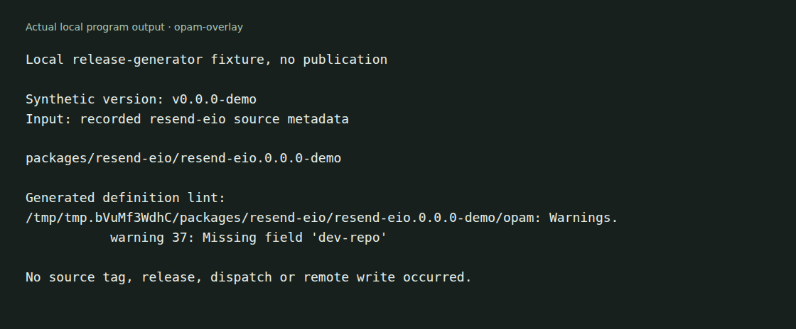

# OCaml release overlay

An opam repository and release generator for a set of OCaml libraries. The
allowlist maps source repositories to package names; a GitHub Actions workflow
can turn an approved source tag into package definitions.



The capture runs the real generator in a temporary directory. It does not
publish a package or create a source tag. See [capture details](docs/demo/README.md).

## Current contents

There are no published package versions checked into this revision. Registering
this repository with opam does not make an unpublished source package available.
Use a source checkout or wait for a package version to appear under `packages/`.

[release-manifest.json](release-manifest.json) lists the allowed source repositories
and package names. The entries use the current GitHub repository locations,
including `olegpustovit/oauth2-eio` and libraries under `Microapps-Labs`.

## Use published packages

Once the required versions exist in this repository, add it to a development
switch:

```sh
opam repository add microapps-overlay \
  git+https://github.com/Microapps-Labs/opam-overlay.git --this-switch
opam repository set-repos --this-switch microapps-overlay default
```

Inspect the available package versions before trying to install one. This does
not replace the default opam repository or create package releases by itself.

## Run the local fixture

With `uv`, Python 3.12 or later, opam and tar available:

```sh
sh docs/demo/run.sh
```

The runner copies the generator and recorded source metadata into a temporary
directory, then creates and lints a synthetic package version. It removes that
directory when it exits.

## Release process

The repository-dispatch workflow receives a source repository and `v<version>`
tag. It checks the allowlist, resolves the tag, downloads a commit-addressed
archive, and invokes [scripts/publish_release.py](scripts/publish_release.py).
The generator adds archive checksums and pins sibling packages to the same
version. It rejects attempts to overwrite an existing package version.

The workflow needs its configured dispatch credential. Credential setup and a
successful source tag are separate from this local fixture run. No release was
triggered as part of the capture.
